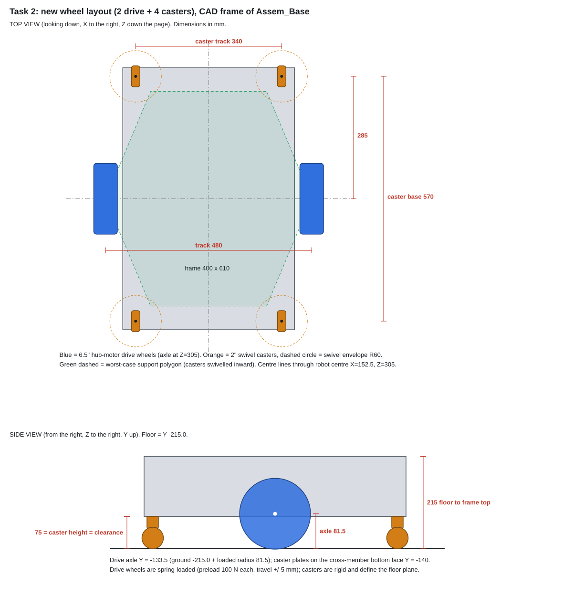

# Task 2: Wheel layout, diameters and alignment (v1, 2026-10-09)

New layout for the AGV base, like the RobiHaul / MiR style robots: **2 drive wheels at mid-length (one per side) + 4 swivel casters at the corners**. It replaces the 4 mecanum wheels of the old robot.



**Files in this folder**

| File | What it is | Who needs it |
|---|---|---|
| `wheel_layout_report.md` | This report: decisions, numbers, checks | Everyone |
| `wheel_layout_drawing.svg` | Dimensioned top + side view | Tasks 1, 4, 5 |
| `wheel_layout_coordinates.csv` | Exact coordinates of the axles, caster axes and floor plane (CAD frame) | Tasks 1, 5, 10 |
| `wheel_layout_calculator.xlsx` | Live calculator: change an input, all results update | Task 2, 6, 8 |
| `hub_motor_size_comparison.csv` | 6.5 in vs 8 in vs 10 in hub motors | Task 8 |
| `calc/wheel_layout_calc.py` | Same calculation in Python; regenerates the SVG and CSV files | Task 2 |

## 1. Coordinate system and starting geometry (measured from the CAD)

All numbers use the frame of **`Assem_Base.SLDASM`**, read with the SolidWorks API: **X = width, Y = up, Z = length, mm**.

| Item | Value |
|---|---|
| Profile frame (outer) | X −47.5 → 352.5 (400 mm), Z 0 → 610, Y −140 → 0 |
| Robot centre line | X = 152.5, Z = 305 |
| Lower 400 mm cross members (caster mounting face) | bottom face **Y = −140**, centre lines Z = 20 and Z = 590 |
| Lower 600 mm side rails | X 0–40 and 265–305, Y −120 → −100 |
| Old mecanum wheels | **Ø133 mm** (not 122 mm as in the old URDF), centre Y = −94.8 → old floor at **Y ≈ −161.8**, only 22 mm under the frame |
| Old robot height | table top 165 mm, LiDAR top 204 mm above the floor |
| Mass in CAD | 8.75 kg (includes the old wheels and brackets) |

### Where is (0, 0, 0)?

All X / Y / Z values are measured from the **Origin of `Assem_Base.SLDASM`** (the one shown in the SolidWorks feature tree). On the real frame, that origin is a corner:

| Axis | Zero is… | Positive direction |
|---|---|---|
| **X = 0** | the **outer face of the LEFT side profile** (600 mm profiles, X 0–40) | towards the right side profile (its outer face is X = 305) |
| **Y = 0** | the **top face of the frame** (top of the upper 600 mm side profiles) | **up**. So everything below the frame top is negative |
| **Z = 0** | the **end face of the cross members at the lift-motor end** (the NEMA 23 stepper of the lift and LiDAR 1 are at this end) | towards the other end (frame length 610) |

The same locations, measured from the frame with a ruler:

| Item | From the frame |
|---|---|
| Drive axle, left / right | **87.5 mm outside** the outer face of the left / right side profile · **133.5 mm below the frame top** (= 6.5 mm above the frame bottom) · **305 mm** from the motor-end face = exactly **mid-length** |
| Casters | swivel axis **17.5 mm outside** the left / right side profile (30 mm in from the end of the 400 mm cross member) · on the **centre line of the lower cross members** (20 mm in from each end face) · plate on the **bottom face** of the cross member |
| Floor | **215 mm below the frame top** = **75 mm below the frame bottom** |
| Robot centre | midway between the side profiles (152.5 from the left outer face) and mid-length (305) |

> If you put this layout into another assembly, insert `Assem_Base` with its origin coincident to the new origin (or mate the frame to these faces); then all the coordinates in `wheel_layout_coordinates.csv` stay valid.

### Same points in the robot frame `Base_Coordinate` (for the URDF, Task 10)

The assembly also has a coordinate system **Base_Coordinate** (robot frame used for the URDF). It is **not** the Origin: it sits at X 152.5, Y −119.47, Z 307.5 of the assembly, with **robot +X = forward = towards the Z = 0 end** (lift-motor end, where FR/FL_Point are), **robot +Y = left** (the X = 0 side profile is the robot's left), **robot +Z = up**.

So the **front of the robot is the Z = 0 end** (lift motor + LiDAR 1). Casters 1–2 are the front pair.

| Item | x (m, forward) | y (m, left) | z (m, up) |
|---|---|---|---|
| Drive axle, left | +0.0025 | +0.2400 | -0.0140 |
| Drive axle, right | +0.0025 | -0.2400 | -0.0140 |
| Caster 1 (front left) | +0.2875 | +0.1700 | -0.0205 |
| Caster 2 (front right) | +0.2875 | -0.1700 | -0.0205 |
| Caster 3 (rear left) | -0.2825 | +0.1700 | -0.0205 |
| Caster 4 (rear right) | -0.2825 | -0.1700 | -0.0205 |
| Floor | | | -0.0955 |

> The drive axles are 2.5 mm behind Base_Coordinate (frame mid-length is Z 305, Base_Coordinate is at Z 307.5). For differential drive, base_link should sit on the axle line, so Task 10 should move Base_Coordinate to Z 305, or accept the 2.5 mm offset.

**Old wheel hardware to remove** (only used by the mecanum wheels, all outside the frame): `Mecanum-Wheel` ×4, `Part3` ×4, `Part4` ×4, `Part5` ×16, `Part10` ×4, `Part11` ×4, `Part12` ×4. Keep `Part9` (frame corner brackets).

## 2. The key design decision: spring-loaded drive wheels

Six wheels on a rigid frame cannot all touch a real floor. If the casters end up even 1 mm lower than the drive wheels, the drive wheels lift and lose traction. If the drive wheels are lower, the robot rocks on them.

Commercial AMRs solve this the same way, and so do we:

- The **4 casters are rigid** and define the floor plane (with shims to level them).
- The **2 drive wheels sit on a spring suspension** that presses each one on the floor with a known force (**preload ≈ 100 N each**, adjustable 80–150 N) over a working travel of **±5 mm**.

## 3. Wheel sizes

### Drive wheels: 6.5 in hoverboard hub motor (recommended)

| Size | Ø (mm) | Wheel top vs frame top | Torque per wheel, loaded, 2° slope, 0.5 m/s² | Wheel rpm at 1 m/s | Verdict |
|---|---|---|---|---|---|
| **6.5 in** | 165 | 50 mm **below** | **5.25 N·m** | 116 | ✅ Fits inside the body height, lowest torque need, the most common and cheapest size |
| 8 in | 203 | 12 mm below | 6.5 N·m | 94 | Possible, but bigger wheel wells and more torque for no benefit indoors |
| 10 in | 254 | 39 mm **above** | 8.1 N·m | 75 | ❌ Taller than the frame; only useful outdoors |

Reference: 6.5 in hub motors are self-contained brushless motors with a solid rubber tyre, about **3.1 kg**, 250–350 W, 12–36 V, ~600 rpm no-load at 36 V ([Parallax](https://www.parallax.com/?p=16596)). Robotics versions are rated for about 80 kg per wheel ([MakerStore](https://www.makerstore.com.au/?p=157026)). Our need of **≈5.3 N·m** is well within what these motors give.

> ⚠️ **Measure the purchased motor** (tyre Ø, tyre width, axle stub length, axle flats) and update the calculator. All positions follow automatically.

### Casters: 2 in (50 mm) swivel, rated ≥ 60 kg each

| Candidate | Height | Rating | Spacer to reach 75 mm |
|---|---|---|---|
| Revvo 50 mm low-profile twin nylon ([RS](https://uk.rs-online.com/web/p/castor-wheels/0750834)) | 64 mm | 160 kg | 11 mm |
| Richelieu 50 mm twin nylon, brake ([Home Depot](https://www.homedepot.ca/product/richelieu-2-inch-50-mm-contemporary-twin-wheel-nylon-swivel-caster-with-brake-silver-and-black-60-kg/1001090267)) | 73 mm | 60 kg | 2 mm |
| Generic 50 mm PU plate caster ([VXB](https://vxb.com/products/2-inch-swivel-plate-casters-blue-50-pack)) | 70 mm | 29.5 kg | ❌ too weak |

Required rating: **54 kg per caster** (worst loaded case × 1.5, because 4 rigid casters on an uneven floor do not share the load equally).

## 4. Vertical alignment: putting all 6 contact points on one plane

The casters bolt (through a spacer/adapter plate) to the **bottom face of the lower cross members, Y = −140**. The installed caster height sets the floor:

```
Floor          Y_floor = Y_mount − H_caster          = −140 − 75      = −215.0
Drive axle     Y_axle  = Y_floor + D/2 − δ_tyre     = −215 + 82.5 − 1 = −133.5   (suspension at mid-travel)
Caster spacer  t       = H_caster(design) − H_caster(datasheet)          e.g. 75 − 73 = 2 mm
```

| Result | Value |
|---|---|
| Floor level | **Y = −215.0** |
| Drive axle centre (mid-travel) | **Y = −133.5** |
| Ground clearance under the frame | **75 mm** (old robot: 22 mm) |
| Robot height change vs old robot | **+53 mm** (table top 218 mm, LiDAR top 258 mm above the floor) |

> ⚠️ **Check with the team:** the robot becomes 53 mm taller. Confirm the racks still clear the robot (lowered table at 218 mm). If not, use lower-profile casters (the 64 mm Revvo gives −11 mm) and/or mount the caster plates higher inside the frame corners.

## 5. Plan positions (top view)

| Item | X | Y | Z |
|---|---|---|---|
| Drive axle, left | **−87.5** | −133.5 | **305** |
| Drive axle, right | **392.5** | −133.5 | **305** |
| Caster 1 (left, Z = 0 end) | −17.5 | −140 (plate) | 20 |
| Caster 2 (right, Z = 0 end) | 322.5 | −140 | 20 |
| Caster 3 (left, Z = 610 end) | −17.5 | −140 | 590 |
| Caster 4 (right, Z = 610 end) | 322.5 | −140 | 590 |
| Robot centre / rotation centre | 152.5 | floor | 305 |

- **Track (drive wheels): 480 mm.** The tyres sit outside the side rails, 60 mm from the rail face (room for the axle clamp and suspension) and about 37 mm from the side panels. Overall width over the tyres is **535 mm** (old robot: 650 mm).
- **Drive axle at mid-length (Z = 305).** The robot turns on the spot about its own centre. In-place rotation radius, including the LiDAR housings: **411 mm**.
- **Casters:** 340 mm (X) × 570 mm (Z), on 60 × 60 mm adapter plates (the caster plates are 38–51 mm wide, the profile is 40 mm). Keep a **R60 mm swivel circle** around each caster axis free of brackets and the cover skirt.

## 6. Loads, traction and stability

Masses: empty robot **30.2 kg** (mass budget sheet, +10% margin), design payload **100 kg** (GP1 sizing basis), loaded 130.2 kg.

| Check | Result | Comment |
|---|---|---|
| Drive force, loaded, flat, a = 0.5 m/s² | 84 N total, 3.4 N·m per wheel | |
| Drive force, loaded, 2° slope, a = 0.5 m/s² | 129 N total, **5.25 N·m per wheel** | Torque requirement for the motors |
| Preload per drive wheel | **100 N** = 68% of the empty weight | Casters still carry 24 N each when empty |
| Max acceleration before slip, loaded, flat | 0.62 (μ = 0.5) / **0.47 m/s²** (μ = 0.4) | → **limit loaded acceleration to 0.4 m/s²** in the motor controller |
| Same, loaded, 2° slope (μ = 0.4) | 0.13 m/s² | Avoid ramps when loaded, or raise the preload if the robot gets heavier |
| Load per caster, loaded | 269 N static, **354 N worst** | → caster rating ≥ 54 kg |
| Tip-over acceleration limit, loaded, lift up | **3.4 m/s²** | About 8× the acceleration we use: very stable |
| Tip-over limit, empty | 14.5 m/s² | |

**Suspension spring:** the force should stay close to the preload, so keep it soft. At the wheel, the rate should be **≤ 5 N/mm**, with about 20 mm preload compression and ±5 mm working travel. With a swing arm, the spring rate is (5 N/mm)/i² and the spring force is 100 N/i, where i = spring travel / wheel travel. The calculator does this conversion.

## 7. Alignment and build tolerances (checklist for Task 9)

- [ ] All 4 casters at the same installed height: **±0.5 mm** (use 0.5 / 1 / 2 / 5 / 10 mm aluminium shims)
- [ ] Caster swivel axes vertical within 1°
- [ ] Both drive axles **coaxial**: same Z (305 ± 0.5 mm) and same Y; toe ≤ 0.5°, camber ≤ 1°. Misalignment makes the robot drift and spoils the odometry
- [ ] Drive wheels symmetric about X = 152.5 (± 1 mm)
- [ ] Suspension at mid-travel when the robot stands on a flat floor; adjust the preload to 100 N (a luggage scale under the wheel works)

## 8. What each task should take from this

- **Task 1 (Chassis CAD):** Delete the old wheel hardware (section 1). Add 2 drive modules on the outer faces of the lower side rails at Z = 305, with the axle at X −87.5 / 392.5 and Y −133.5. Add 4 caster adapter plates under the cross members at the positions in section 5. Use `wheel_layout_coordinates.csv`.
- **Task 4 (Cover):** The wheel wells must clear a Ø165 × 55 mm tyre plus ±5 mm suspension travel (wheel top at Y −50). Keep the cover skirt above Y −215 + 10 mm, and keep the caster R60 swivel circles free.
- **Task 5 (Assembly) and Task 6 (Stress):** Loads into the frame are 2 × 100 N drive preload plus caster loads up to 354 N each, at the positions above.
- **Task 8 (Purchase list):** 2 × 6.5 in hoverboard hub motors (36 V, with Hall sensors) and drivers; 4 × 2 in swivel casters rated ≥ 60 kg (2 with brakes); 4 adapter plates 60 × 60 × 5 mm plus a shim set; 2 suspension springs/shocks (rate per the calculator).
- **Task 10 (URDF) and the software team:**
  - The robot is now **differential drive**: wheel radius **0.0815 m** (loaded; measure), wheel separation **0.480 m**.
  - Put base_link **on the floor under the robot centre (X 152.5, Z 305)**. The frame top is 0.215 m above the floor.
  - The 4 casters become passive swivel joints.
  - The Nav2 motion model changes from Omni to DiffDrive.

## 9. Open points

1. Measure the real hub motor and caster, update the calculator, and re-check the positions.
2. Confirm the +53 mm robot height against the racks.
3. Confirm the empty mass once the parts are bought, and assign materials to every CAD part.
4. ~~Decide which end is the front~~: the CAD already defines it, so the **front is the Z = 0 end** (see the Base_Coordinate section).
5. Suspension concept: a vertical slide or a trailing arm. This goes to Task 1.
