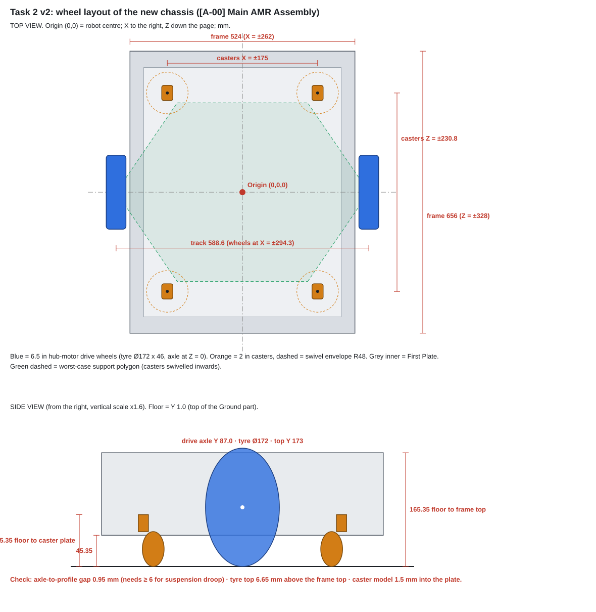

# Task 2 v2: Wheel layout check of the new chassis (2026-10-20)

This version replaces v1. v1 was based on the old robot frame (`Assem_Base`); it is kept in [`archive_v1_old-frame/`](archive_v1_old-frame/).

**Source:** `Phase-A_design/01_chassis-cad/CAD/[A-00] Main AMR Assembly.SLDASM` (latest on GitHub, commit `e98996c`), read with the SolidWorks API. Task 1 has already placed the wheels and casters, so this version **checks their layout**, calculates the loads, and lists exactly what must change.

| File | What it is |
|---|---|
| `wheel_layout_report.md` | This report |
| `wheel_layout_drawing.svg` | Top + side view with dimensions, as modelled |
| `wheel_layout_coordinates.csv` | Coordinates of the axles, caster axes and floor, as modelled |
| `wheel_layout_calculator.xlsx` | Live calculator (inputs = CAD measurements; change them and everything updates) |
| `calc/wheel_layout_calc.py` | Same calculation in Python; regenerates the SVG and CSV |

---

## 1. The reference point (0, 0, 0)

Task 1 moved the origin to the **centre of the robot**:

| Axis | Zero is… | Positive direction |
|---|---|---|
| **X** | the robot's centre line (half-way between the two side profiles) | towards one side; the frame faces are at **X = ±262** |
| **Z** | the robot's mid-length (half-way between the two ends) | towards one end; the frame faces are at **Z = ±328** |
| **Y** | the **underside of the 1 mm `[A-02] Ground` part** | up |

> ⚠️ Because Y = 0 is the underside of the Ground part, **the floor surface is at Y = +1.0**. Every height above the floor = Y − 1.0. (Suggestion for Task 1: mate the Ground part so its **top** face is at Y = 0. Then Y = height above the floor, and nobody has to remember the 1 mm.)
>
> The CAD is symmetric, so it does not say which end is the **front**. Please decide it (the end with the main LiDAR) and write it in the Task 1 README.

## 2. What Task 1 modelled (measured)

| Item | Where (mm) |
|---|---|
| Frame (3030 profiles) | X **±262** (524 wide) · Z **±328** (656 long) · Y **46.35 → 166.35** |
| Bottom profiles | Y 46.35 → **76.35** |
| First Plate (3 mm) | X ±230 · Z ±290 · Y 76.35 → 79.35, sitting on the bottom profiles |
| Lowest chassis parts (cross joints, tee brackets) | Y **36.35** |
| **Drive wheels** (6.5 in hub motor) | tyre **Ø172 × 46**, mid-plane **X = ±294.3**, axle centre **Y = 87.0, Z = 0** |
| Drive axle shaft | Ø19.4, from X ±216.2 (inner end, inside the frame) to ±323.2 |
| **Casters** (2 in, with brakes) | swivel axis **X = ±175, Z = ±230.8**; plate under the First Plate (Y 76.35); wheel Ø50.7, lead 23 mm |
| Floor | **Y = 1.0** |

**Good news:** the six contact points are on one plane. The casters touch Y = 1.0, and the drive tyres also touch Y = 87.0 − 86 = **1.0**.

## 3. Problems found, and the fix

### ❌ Problem 1: the drive axle sits on the bottom side profile (no room for the suspension)

At Z = 0 the hub-motor axle passes **over the bottom side profile** (X 232–262, top at Y 76.35):

- **As modelled:** the gap between the axle and the profile is **0.95 mm**.
- **Under the robot's weight:** the solid tyre compresses about 1 mm, so the gap becomes **−0.05 mm**. The axle rests on the profile.
- **What the suspension needs:** the wheel must be able to drop **≥ 5 mm** into floor dips, plus 1 mm clearance, so the gap must be **≥ 6 mm**.

The axle height above the floor is fixed by the tyre radius, so **the frame has to come down instead**:

> ✅ **Fix (recommended): lower the frame 7 mm relative to the floor**, by using shorter casters.
>
> In the CAD, keep the frame where it is and:
> 1. move **`[A-02] Ground` up 7 mm**, so the floor surface goes from Y 1.0 to **Y 8.0**;
> 2. move the **hub-motor axle up 7 mm**, from Y 87.0 to **Y 94.0** (unloaded; it sits at Y 93.0 when loaded);
> 3. change the casters to an **installed height of 68.35 mm** (floor to the underside of the First Plate). For example, the **Revvo 50 mm low-profile caster (64 mm, 160 kg)** plus a **4.35 mm spacer**.
>
> Result:
> - the axle gap under load becomes **6.95 mm** ✔
> - ground clearance is **28.35 mm** under the cross joints and 38.35 mm under the frame. That is OK on a warehouse floor; the casters limit door thresholds to about 5–8 mm anyway.

Other options, not recommended: a bigger tyre (8 in), which raises the axle but puts the tyre 33 mm above the frame top; or cutting the bottom side profile at the wheel, which weakens the frame.

### ❌ Problem 2: the caster model does not fit its space

The caster model is **76.85 mm** tall (floor to the top of its plate), but the space between the floor and the First Plate is **75.35 mm**, so the model pokes **1.5 mm into the plate**. With the fix above the space becomes 68.35 mm, so **choose a caster ≤ 68 mm tall** and fill the rest with a spacer.

### ⚠️ Problem 3: the tyres stick out above the frame

The tyre top is at Y 173.0, **6.65 mm above the frame top** (Y 166.35). After the fix it is 13.65 mm above. **Task 4 (cover):** the side and top panels need wheel wells around Ø172 + 10 mm, plus ±5 mm suspension travel. **Task 3:** keep the lift clear of X ±271 → ±318, Z ±96.

### ⚠️ Problem 4: the suspension is not modelled yet

The axle is fixed to the frame, so there is no spring yet. **Task 1** needs to add one drive module per side: a vertical slide (2 linear bearings + 2 coil springs, the same idea as the [Tata AMR patent](https://patents.google.com/patent/US12128554)).

| Spec | Value |
|---|---|
| Force pressing each wheel on the floor (preload) | **120 N** |
| Spring rate at the wheel | **≤ 6 N/mm** (preload compression about 20 mm) |
| Travel | **±5 mm** around the loaded position (axle Y 93.0 after the fix) |
| Space | tyre inner face to frame is **9.3 mm** (X 262 → 271.3) |

The inner end of the axle (X ±216.2) is inside the frame. That is where the clamp/slide goes, between the bottom (Y ≤ 76.35) and top (Y ≥ 136.35) side profiles.

### ⚠️ Problem 5: no materials in the CAD

SolidWorks gives a 3030 profile 0.157 kg (the real one is about 0.6 kg) because no material is assigned. **Task 1:** assign aluminium (6063-T5 for the profiles, 5052/6061 for the plate). Until then, the calculations use the mass budget in the calculator (**36.8 kg** empty).

### ⚠️ Problem 6: the First Plate carries the casters

Each caster pushes up to **385 N** into a **3 mm** plate. **Task 6:** check the plate's bending at the caster mounts. If it is too flexible, use 5 mm or bolt the casters to profiles.

## 4. Final positions (after the fix), in the Task 1 frame

| Item | X | Y | Z |
|---|---|---|---|
| Floor surface | | **8.0** | |
| Drive axle, left / right (unloaded, as in CAD) | **∓294.3** (tyre mid-plane) | **94.0** | **0** |
| Drive axle when loaded (suspension mid-travel) | ∓294.3 | 93.0 | 0 |
| Casters (4) swivel axis | **±175** | plate face 76.35 (68.35 above the floor) | **±230.8** |
| Robot centre / rotation centre / base_link | 0 | floor (8.0) | 0 |

The plan view does not change. If Task 1 instead moves the Ground so its top is at Y = 0, subtract 8 from every Y above.

## 5. Loads and checks (calculator, empty 36.8 kg + 100 kg payload)

| Check | Result |
|---|---|
| Track / width over tyres | **588.6 mm** / 634.6 mm |
| Caster track / wheelbase | 350 / 461.6 mm |
| In-place rotation radius (frame corners, without cover) | 419.8 mm |
| Torque per drive wheel (loaded, 2° slope, 0.5 m/s²) | **5.75 N·m** (fine for a 6.5 in hub motor) |
| Wheel speed at 1 m/s | 111 rpm |
| Drive preload | **120 N per wheel** = 66% of the empty weight (each caster still carries 30 N when empty) |
| Load per caster, loaded | 276 N static, **385 N worst** → **caster rating ≥ 59 kg** (Revvo 160 kg ✔) |
| Max acceleration before slip, loaded, flat | 0.73 (μ 0.5) / **0.55 m/s²** (μ 0.4) → limit to **0.5 m/s²** |
| Same on a 2° slope (μ 0.4) | 0.21 m/s² → go slowly on ramps when loaded |
| Tip-over limit, loaded with the lift raised | **3.1 m/s²** (very stable) |

## 6. What each task should do now

- **Task 1:** apply the fix in section 3 (Ground +7, axle +7, casters 68.35 mm). Add the drive suspension modules. Assign materials. Mark the front.
- **Task 3:** keep the lift out of the wheel zone (section 3, problem 3).
- **Task 4:** wheel wells for Ø172 tyres sticking out 13.65 mm above the frame top, plus ±5 mm travel.
- **Task 6:** First Plate bending at the casters (385 N each); drive preload of 2 × 120 N into the side profiles.
- **Task 8:** 2 × 6.5 in hoverboard hub motors (measure the real tyre: Ø172 assumed); 4 × low-profile 2 in casters **≤ 68 mm tall, ≥ 60 kg** (2 with brakes); spacer plates (4.35 mm + shims); 4 coil springs about 3 N/mm each (2 per wheel → 6 N/mm per wheel) for the slides.
- **Task 10 / software:** differential drive, wheel radius **0.085 m** (loaded), wheel separation **0.5886 m**, base_link on the floor under the origin.

## 7. Open points

1. The team confirms the 7 mm lowering, or picks another option.
2. Measure the real hub motor (tyre Ø, axle Ø, length) and the real caster. Update the yellow cells in the calculator.
3. Define the front end.
